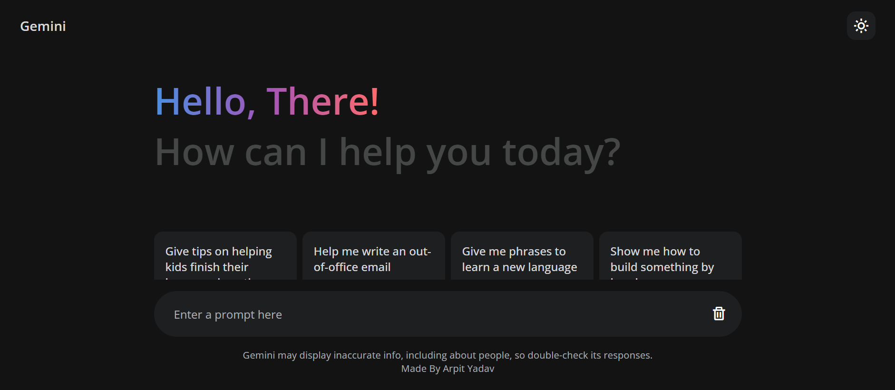

# Gemini clone

A browser-based chat interface built with HTML, CSS and JavaScript to experiment with Google's Gemini API. Chat history and theme settings are stored in the browser.

## Run locally

Use `vercel dev` with Node.js and the Vercel CLI. Set `GEMINI_API_KEY` in the server environment. Optionally set `GEMINI_MODEL` to an available model; the default is `gemini-3.8-flash`.

The browser sends prompts to `/api/gemini`. The key stays on the server. Replies are rendered as text, and requests have a length limit, timeout and a basic per-instance rate limit. Configure provider quotas and distributed abuse protection before operating a public shared-key service.

## Screenshot

